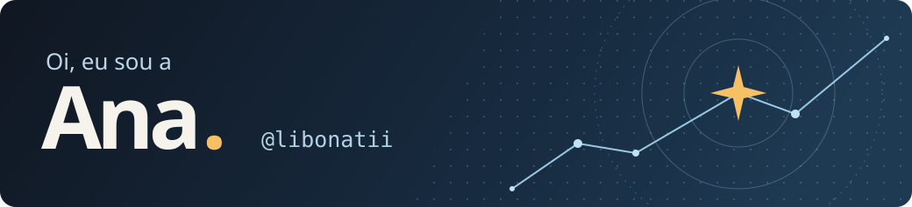

Estudo Direito, faço estágio no Tribunal de Justiça e estou **aprendendo engenharia de software** enquanto desenvolvo o Lume. Também me interesso por automação e análise de dados aplicadas ao Direito.

## ✦ Lume

O Lume é a plataforma social de estudos que estou construindo. Dá para fechar um PDF e voltar à página em que você parou, encaixar aulas no tempo disponível da semana e acompanhar conquistas com amigos.

[Abrir o Lume ↗](https://lumeacademy.site) · [Explorar o código ↗](https://github.com/libonatii/Lume)

**E se o navegador enviar a mesma conclusão de aula duas vezes?** No Lume, o servidor registra a conclusão e os pontos na mesma transação. Se o pedido se repetir, a pessoa recebe os pontos uma única vez. Esse comportamento é um exemplo de *idempotência*.

## Tecnologias que uso no Lume

| Onde uso | O que faço com elas |
| --- | --- |
| **Interface** | Escrevo as telas em **JavaScript e React**. O **Astro** gera o site e uso **CSS** para adaptar a leitura ao celular e ao desktop. |
| **API e dados** | A mesma API roda em **Node.js** com **SQLite** localmente e em **Cloudflare Workers** com **D1** na nuvem. Os PDFs e as imagens ficam no **R2**. |
| **Mensagens** | Uso **WebSocket** e **Durable Objects** para avisar quem está conectado quando chega uma mensagem. |
| **Desktop e extensão** | Com **Electron**, levo o Lume para uma janela própria. A extensão **Manifest V3**, empacotada com **esbuild**, lê o curso aberto no navegador para a pessoa revisar e importar. |
| **Testes** | Verifico regras de negócio com **node:test** e percorro fluxos reais de navegador com **Playwright**. A suíte roda no **GitHub Actions**. |

Também trabalho com imagem e vídeo usando **Photoshop**, **Premiere Pro** e **Vegas**.

Meu histórico de contribuições

<picture>
  <source media="(prefers-color-scheme: dark)" srcset="https://raw.githubusercontent.com/libonatii/libonatii/output/github-contribution-grid-snake-dark.svg" />
  
</picture>

